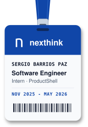

  <picture><source media="(max-width: 1011px)" srcset="assets/mobile/header.svg" /></picture>

  
  
  
  

## About me

  <picture><source media="(max-width: 1011px)" srcset="assets/mobile/card-about.svg" /></picture>

## Experience

<table>
  <tr>
    <td rowspan="5" align="center"><a href="https://nexthink.com"><picture><source media="(max-width: 1011px)" srcset="assets/mobile/badge-nexthink.svg" width="104" height="237" /></picture></a> &nbsp;&nbsp;&nbsp;&nbsp;&nbsp;&nbsp;&nbsp;&nbsp;&nbsp;&nbsp;&nbsp;&nbsp;&nbsp;&nbsp;&nbsp;&nbsp;&nbsp;&nbsp;&nbsp;&nbsp;&nbsp;&nbsp;&nbsp;&nbsp;</td>
    <td>Frontend and backend work on the microfrontend orchestration layer of <b>Nexthink Infinity</b> (TypeScript, React, Java, GraphQL).</td>
  </tr>
  <tr>
    <td>Wrote a jscodeshift codemod that added a <code>RetryPlugin</code> to <b>37 repositories owned by about 20 teams</b>.</td>
  </tr>
  <tr>
    <td>Sped up the Playwright E2E suite on production builds, and defined Datadog synthetic tests as code with Terraform.</td>
  </tr>
  <tr>
    <td>Day to day with GitHub Actions, Jenkins, Docker, GitOps, Kubernetes, Crossplane and AWS.</td>
  </tr>
  <tr>
    <td>🏆 <b>Jury's Special Award</b> at the <i>Nexthink Avengers Innovathon 2025</i>: an MVP of <i>Business Performance</i>, with KPI dashboards and an AI assistant.</td>
  </tr>
</table>

## Featured projects

  <a href="https://github.com/CodeInIA/votain"><picture><source media="(max-width: 1011px)" srcset="assets/mobile/card-votain.svg" /></picture></a>
  <a href="https://brinejar.tech"><picture><source media="(max-width: 1011px)" srcset="assets/mobile/card-brinejar.svg" /></picture></a>

  <a href="https://github.com/josanchdev/Space-Atlas"><picture><source media="(max-width: 1011px)" srcset="assets/mobile/card-space-atlas.svg" /></picture></a>
  <a href="https://github.com/josanchdev/Qubic-Monitor"><picture><source media="(max-width: 1011px)" srcset="assets/mobile/card-qubic-monitor.svg" /></picture></a>

  <a href="https://trustmrr.com/startup/cunadismo-ilustrado"><picture><source media="(max-width: 1011px)" srcset="assets/mobile/card-cunadismo.svg" /></picture></a>
   
  Source: <a href="https://github.com/CodeInIA/cunao-frontend">storefront and admin panel</a> · <a href="https://github.com/CodeInIA/cunao-backend">API</a>

### More projects

| Project | What it is | Stack |
|---|---|---|
| [Phobia](https://github.com/CodeInIA/phobia) | First-person horror maze where a flashlight is your only light, written on modern OpenGL 3.3 Core | C++, OpenGL, GLSL |
| [minecraft-mod-updater](https://github.com/CodeInIA/minecraft-mod-updater) | The original Python version of Brinejar, kept as a legacy project | Python |
| [RingDoor](https://github.com/josanchdev/RingDoor) | IoT access control with NFC and fingerprint, ESP32-CAM security photos | C++, ESP32, Node.js |
| [ReTicket](https://github.com/Jjoaquin04/reticket) | Ticket sales platform with MVC and Spring Security | Java, Spring Boot, JPA, MySQL |

## Tech stack

| Area | Tools |
| --- | --- |
| **Languages** | <picture><source media="(max-width: 1011px)" srcset="assets/mobile/stack-languages.svg" /></picture> |
| **Frontend &amp; desktop** | <picture><source media="(max-width: 1011px)" srcset="assets/mobile/stack-frontend.svg" /></picture> |
| **Backend &amp; data** | <picture><source media="(max-width: 1011px)" srcset="assets/mobile/stack-backend.svg" /></picture> |
| **Blockchain** | <picture><source media="(max-width: 1011px)" srcset="assets/mobile/stack-blockchain.svg" /></picture> |
| **Cloud &amp; DevOps** | <picture><source media="(max-width: 1011px)" srcset="assets/mobile/stack-devops.svg" /></picture> |
| **Testing** | <picture><source media="(max-width: 1011px)" srcset="assets/mobile/stack-testing.svg" /></picture> |
| **AI-assisted dev** | <picture><source media="(max-width: 1011px)" srcset="assets/mobile/stack-ai.svg" /></picture> |

  

