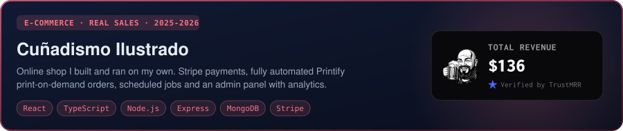
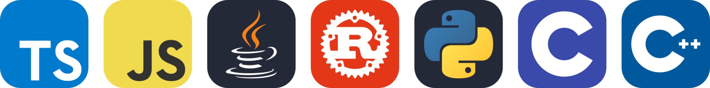
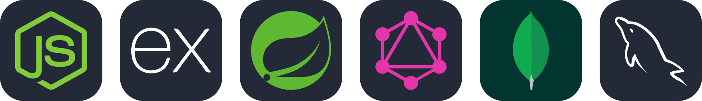
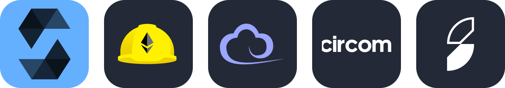
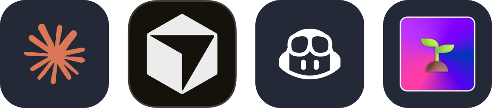

  

  
  
  
  

## About me

  

## Experience

  

## Featured projects

  
  

  
  

  
   
  Source: <a href="https://github.com/CodeInIA/cunao-frontend">storefront and admin panel</a> · <a href="https://github.com/CodeInIA/cunao-backend">API</a>

### More projects

| Project | What it is | Stack |
|---|---|---|
| [Phobia](https://github.com/CodeInIA/phobia) | First-person horror maze where a flashlight is your only light, written on modern OpenGL 3.3 Core | C++, OpenGL, GLSL |
| [minecraft-mod-updater](https://github.com/CodeInIA/minecraft-mod-updater) | The original Python version of Brinejar, kept as a legacy project | Python |
| [RingDoor](https://github.com/josanchdev/RingDoor) | IoT access control with NFC and fingerprint, ESP32-CAM security photos | C++, ESP32, Node.js |
| [ReTicket](https://github.com/Jjoaquin04/reticket) | Ticket sales platform with MVC and Spring Security | Java, Spring Boot, JPA, MySQL |

## Tech stack

| Area | Tools |
| --- | --- |
| **Languages** |  |
| **Frontend &amp; desktop** |  |
| **Backend &amp; data** |  |
| **Blockchain** |  |
| **Cloud &amp; DevOps** |  |
| **Testing** |  |
| **AI-assisted dev** |  |

  

